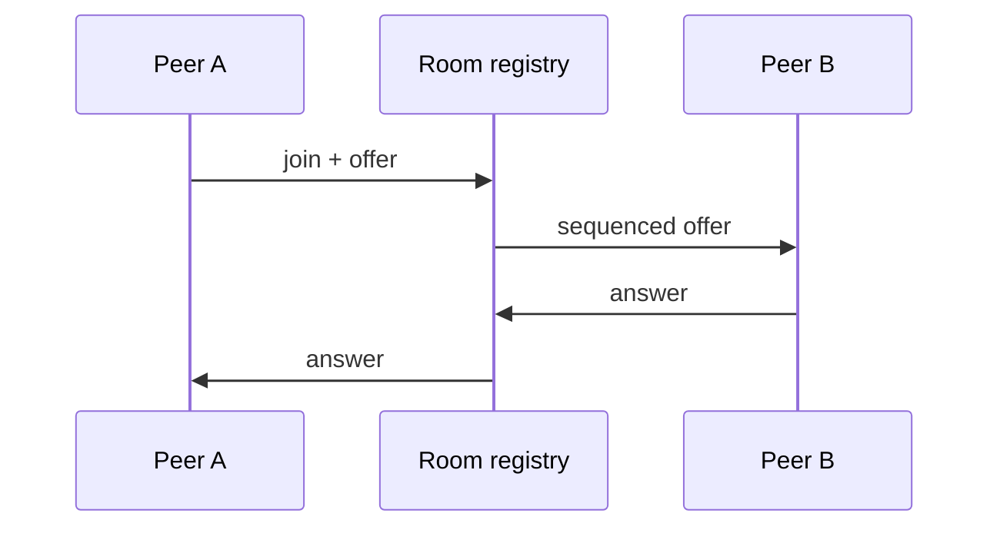

# relayroom

Transport-independent WebRTC signaling primitives in TypeScript.

It covers peer state, reconnect backoff, sequenced room messages, duplicate and cross-room rejection, perfect-negotiation roles, room capacity, stale-peer cleanup, call-quality grading, and adaptive sender profiles.



```sh
npm ci
npm test
```

There is no WebSocket server or media server here. Applications provide the transport, authentication, TURN service, and consent flow.
