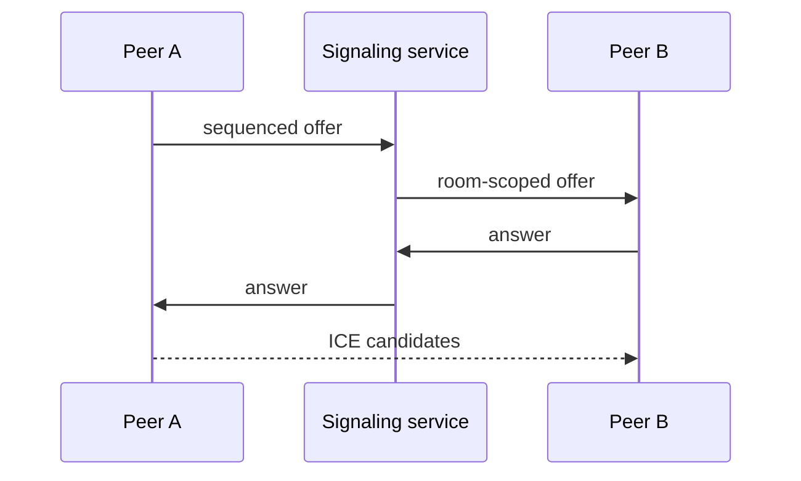

# relayroom

A small WebRTC room and signaling toolkit for applications that need reliable calls without coupling product code to a specific signaling vendor.

The first release contains a testable signaling core with:

- Explicit peer lifecycle and bounded reconnect backoff
- Sequenced, room-scoped signaling messages
- Duplicate, self, and cross-room message rejection
- Polite/impolite roles for perfect-negotiation glare handling
- User-impact call-quality grading from WebRTC statistics

Run `npm install && npm test`. The core is transport-independent; WebSocket signaling, browser adapters, TURN diagnostics, screen sharing, recording consent, and an Angular demo will be added without hiding native WebRTC primitives.

## Non-goals

- Acting as an SFU or media server
- Recording without explicit participant consent
- Treating signaling authentication as optional

